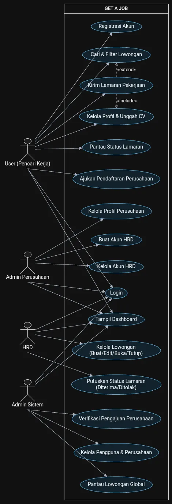
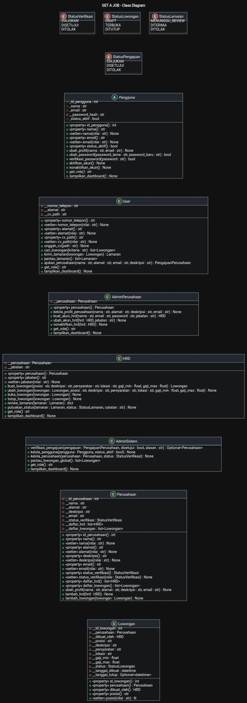

# GET A JOB SISTEM MENCARI LOWONGAN KERJA

Untuk Tugas Akhir Pemrograman Berbasis Objek (PBO). Kelompok 5, yang beranggotakan :

| NPM | Nama |
|---|---|
| 2513030126 | Ilham Wahyu Utama |
| 2513030127 | Aqliza Junior Hikam Ramadhan |


## Arsitektur Program

Proyek ini menerapkan pola arsitektur berlapis (*Layered Architecture*) dan pola *Data Access Object* (DAO) untuk memisahkan entitas domain, logika bisnis, kontrak serta implementasi akses database MySQL, dan antarmuka program:

```tree
oop-loker/
│
├── assets/                          # Dokumentasi diagram UML dan sumber PlantUML
│   ├── useCase.png
│   ├── useCase.md
│   └── classDiagram.md
│
├── models/                          # Representasi data / entity class (OOP Domain)
│   ├── __init__.py
│   ├── enums.py                     # Enum status sistem (3 status lamaran final)
│   ├── pengguna.py                  # Abstract Base Class Pengguna (Abstraksi)
│   ├── user.py                      # Subclass Pencari Kerja (Inheritance)
│   ├── admin_perusahaan.py          # Subclass Admin Perusahaan
│   ├── hrd.py                       # Subclass HRD
│   ├── admin_sistem.py              # Subclass Admin Sistem
│   ├── perusahaan.py                # Class Perusahaan
│   ├── lowongan.py                  # Class Lowongan Pekerjaan
│   ├── lamaran.py                   # Class Lamaran (Association Class)
│   └── pengajuan_perusahaan.py      # Class Pendaftaran Perusahaan
│
├── services/                        # Lapisan logika bisnis & orkestrasi aturan sistem
│   ├── __init__.py
│   ├── auth_service.py              # Autentikasi login, registrasi, & manajemen sesi
│   ├── lowongan_service.py          # Pengelolaan lowongan & filter pencarian
│   ├── lamaran_service.py           # Pengajuan lamaran & keputusan seleksi 3 tahap
│   └── verifikasi_service.py        # Pengajuan & verifikasi pendaftaran perusahaan
│
├── dao/                             # Lapisan akses data MySQL (Interface & Implementasi)
│   ├── __init__.py
│   ├── pengguna_dao.py              # Abstract class (kontrak CRUD Pengguna)
│   ├── pengguna_dao_impl.py         # Implementasi query MySQL untuk Pengguna
│   ├── perusahaan_dao.py            # Abstract class (kontrak CRUD Perusahaan & Pengajuan)
│   ├── perusahaan_dao_impl.py       # Implementasi query MySQL untuk Perusahaan
│   ├── lowongan_dao.py              # Abstract class (kontrak CRUD Lowongan)
│   ├── lowongan_dao_impl.py         # Implementasi query MySQL untuk Lowongan
│   ├── lamaran_dao.py               # Abstract class (kontrak CRUD Lamaran)
│   └── lamaran_dao_impl.py          # Implementasi query MySQL untuk Lamaran
│
├── util/                            # Modul pendukung teknis
│   ├── __init__.py
│   ├── database_connection.py       # Helper koneksi database MySQL
│   ├── session.py                   # Menyimpan sesi pengguna yang sedang aktif
│   └── validator.py                 # Validasi input teks, format email, & rentang gaji
│
└── main.py                          # Entry point program: navigasi menu dinamis per role
```

## USE CASE DIAGRAM

USE CASE DIAGRAM, 4 Aktor dengan beban tugas yang berbeda



Untuk melihat detail spesifikasi aktor, batas sistem, dan kode sumber PlantUML, silakan buka [Dokumentasi Use Case Diagram](assets/useCase.md).

## CLASS DIAGRAM

CLASS DIAGRAM, pemodelan struktur kelas, enkapsulasi atribut, serta relasi antar-entitas sistem.



Untuk melihat rincian atribut, visibilitas, aturan validasi enkapsulasi, serta kode sumber PlantUML, silakan buka [Dokumentasi Class Diagram](assets/classDiagram.md).
