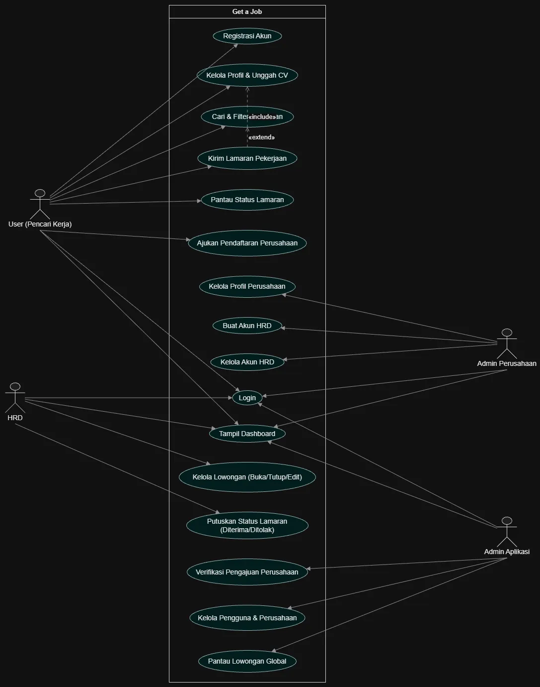

# GET A JOB SISTEM MENCARI LOWONGAN KERJA

Untuk Tugas Akhir Pemrograman Berbasis Objek (PBO). Kelompok 5, yang beranggotakan :

[2513030126] Ilham Wahyu Utama 

[2513030127] Aqliza Junior Hikam Ramadhan

## Arsitektur Program
```tree
oop-loker/
│
├── models/                     # Representasi data / entity class (OOP Domain)
│   ├── __init__.py
│   ├── pengguna.py             # Abstract Base Class Pengguna (Abstraksi)
│   ├── user.py                 # Subclass Pencari Kerja (Inheritance)
│   ├── adminPerusahaan.py     # Subclass Admin Perusahaan
│   ├── hrd.py                  # Subclass HRD
│   ├── adminSistem.py       # Subclass Admin Sistem
│   ├── perusahaan.py           # Class Perusahaan
│   ├── loker.py             # Class Lowongan Pekerjaan
│   ├── lamaran.py              # Class Lamaran (Association Class)
│   └── pengajuanPerusahaan.py # Class Pendaftaran Perusahaan
│
├── dao/                        # Lapisan akses data MySQL (CRUD & PreparedStatement)
│   ├── __init__.py
│   ├── dao.py             # Interface/Abstract DAO dasar
│   ├── penggunaDao.py         # Login, registrasi, ubah role
│   ├── perusahaanDao.py       # CRUD Perusahaan & Verifikasi
│   ├── lowonganDao.py         # CRUD Lowongan (aktifkan, tutup, filter)
│   └── lamaranDao.py          # CRUD Lamaran & update status 3 tahap
│
├── util/                       # Modul pendukung teknis & pembantu UI
│   ├── __init__.py
│   ├── dbConnection.py        # Helper koneksi database MySQL (kredensial terisolasi)
│   ├── session.py              # Menyimpan user yang sedang aktif login
│   └── validator.py            # Validasi input teks, format email, gaji, dll.
│
└── main.py                     # Entry point program: Navigasi CLI, menu dinamis per role
```

## USE CASE DIAGRAM
USE CASE DIAGRAM, 4 Aktor dengan beban tugas yang berbeda

