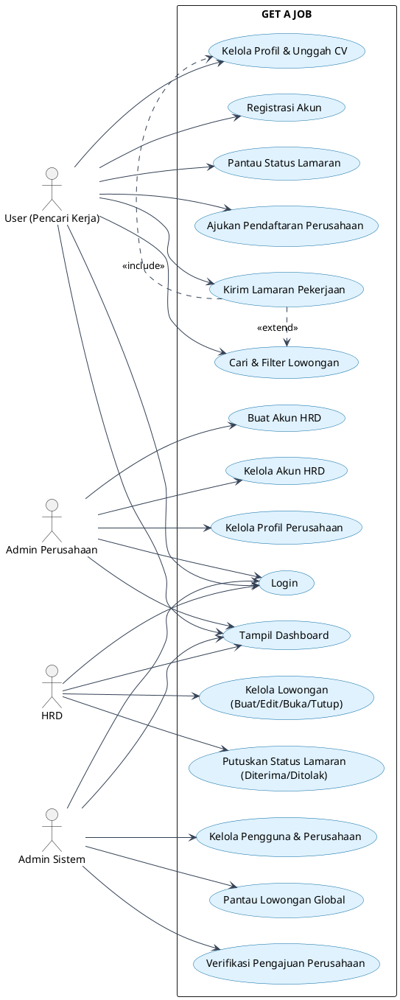

# GET A JOB - Use Case Diagram

## Deskripsi

Use Case Diagram ini menggambarkan interaksi fungsional antara empat jenis aktor dengan sistem **GET A JOB**. Sistem berfungsi sebagai portal pencarian lowongan kerja yang menghubungkan pencari kerja, admin perusahaan, HRD, dan admin sistem dalam satu alur rekrutmen yang terstruktur.

## Aktor dan Tanggung Jawab

### 1. User (Pencari Kerja)
* Melakukan registrasi akun dan login ke sistem.
* Melihat dashboard User.
* Mengelola profil pribadi dan mengunggah CV.
* Mencari dan memfilter lowongan pekerjaan (berdasarkan posisi, lokasi, jenis pekerjaan, dan rentang gaji).
* Mengirim lamaran pekerjaan pada lowongan yang berstatus terbuka.
* Memantau status lamaran (`Menunggu Review`, `Diterima`, atau `Ditolak`).
* Mengajukan pendaftaran perusahaan baru.

### 2. Admin Perusahaan
* Login dan melihat dashboard perusahaan.
* Mengelola profil dan informasi perusahaan.
* Membuat akun HRD baru yang terhubung ke perusahaannya.
* Mengubah dan menonaktifkan akun HRD miliknya (tidak berwenang mengelola seleksi pelamar).

### 3. HRD
* Login dan melihat dashboard HRD.
* Mengelola lowongan pekerjaan perusahaannya (membuat, mengubah, membuka, dan menutup lowongan).
* Meninjau berkas serta CV pelamar dan menetapkan keputusan akhir lamaran (`Diterima` atau `Ditolak`).

### 4. Admin Sistem
* Login dan melihat dashboard administrasi sistem.
* Memverifikasi pengajuan pendaftaran perusahaan dari User (menyetujui dan mempromosikan role pemohon menjadi Admin Perusahaan, atau menolak pengajuan).
* Mengelola akun seluruh pengguna dan status perusahaan.
* Memantau data lowongan pekerjaan secara global.

## Alur Utama

Seluruh aktor melakukan **Login** terlebih dahulu sebelum mengakses layanan sesuai hak akses masing-masing. Setelah autentikasi berhasil, sistem menampilkan **Tampil Dashboard** secara dinamis berdasarkan peran (*role*) akun yang masuk.

1. **User (Pencari Kerja)** melengkapi profil serta CV, mencari lowongan yang tersedia, mengajukan lamaran, memantau hasil seleksi 3 tahap, atau mengajukan pendaftaran perusahaan baru.
2. **Admin Perusahaan** mengelola identitas perusahaan dan mengatur akun HRD yang bekerja di bawah perusahaannya.
3. **HRD** memublikasikan lowongan kerja serta menyeleksi berkas lamaran yang masuk ke lowongan perusahaannya.
4. **Admin Sistem** mengawasi operasional keseluruhan aplikasi dan memvalidasi pengajuan perusahaan baru.

## Relasi Include dan Extend

* **`Kirim Lamaran Pekerjaan` `<<include>>` `Kelola Profil & Unggah CV`:** Proses pengiriman lamaran mewajibkan User memiliki data profil dan berkas CV yang valid terlebih dahulu.
* **`Kirim Lamaran Pekerjaan` `<<extend>>` `Cari & Filter Lowongan`:** Setelah menemukan lowongan yang sesuai melalui pencarian/filter, User dapat melanjutkan ke proses pengiriman lamaran secara opsional.

## Batas Sistem

Kotak **`GET A JOB`** merupakan batas sistem (*system boundary*). Seluruh *use case* yang berada di dalam kotak tersebut merupakan layanan internal aplikasi, sedangkan keempat aktor diletakkan di luar kotak sebagai pihak eksternal yang berinteraksi dengan sistem.

## PlantUML

Salin kode PlantUML berikut ke **draw.io** melalui menu **Arrange > Insert > Advanced > PlantUML** untuk menghasilkan diagram dengan tata letak bersih tanpa label panah yang bertumpuk:

